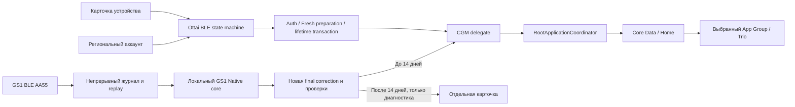

# xDrip+ 4246: техническая передача разработчикам

Current release: **7.2.1 / 4249**. [GS1 extension and current data flow](gs1-extension.md). The 4246 details below are historical; diagnostic-only GS1 behavior has been replaced by the opt-in extended glucose flow.

Дата: 14.11.2026. Версия: 7.2.0 / 4246. Код опубликован одним снимком в ветке `custom-build`; [состав и происхождение снимка](public-snapshot.md). Программные проверки и аппаратные свидетельства ниже разделены.

Навигация: [README](../README.md), [все изменённые файлы](changes-4246.md), [профили подписи](build-profiles.md), [Ottai](ottai-activation.md), [GS1 Native](../Vendor/GS1Native/README.md).

## 1. База и состав интеграции

Это iOS-приложение на базе [upstream xDrip4iOS 7.2.0 / 4234, ba37f261](https://github.com/JohanDegraeve/xdripswift/tree/ba37f261352eedfb7f518c4a38e2266acb0f95e9). Android APK, Gradle и keystore для сборки не используются.

Два основных направления этой передачи — **Ottai/Syai** и **Sibionics GS1 CN**. Они добавлены относительно указанной чистой upstream-базы. Также присутствует третья дополнительная семья — AiDex/LinX/LumiFlex. Поэтому формулировка «добавлены ровно два типа» неполна.

Ottai/Syai заимствован из [PR736](https://github.com/JohanDegraeve/xdripswift/pull/736), исходный donor `d0e212af681d283415a9317b28ca3f17c89795d3`. Он уже содержал BLE auth и части activation/lifetime. Наша интеграция дополняет native Global account contract, подготовку нового сенсора, identity/account guards, durable recovery, обязательный read-back, отдельную active lifetime transaction и NFC-профиль. Современная подготовка сверялась с [JugglucoNG91fed63f](https://github.com/ctqvva/JugglucoNG/tree/91fed63ffb83b5b002186a8574b4af696c3839f9).

GS1 поддерживается для **CN AA55 / V115G**. EU, GS3 и неизвестные encrypted variants не считаются совместимыми автоматически. Native core закреплён на JugglucoNG `11e6e29db7d9055c8fd2e96261812e16f2095f3d`; происхождение и лицензии — в [NOTICE](../Vendor/GS1Native/NOTICE.md).

## 2. Архитектура



### Ottai: состояние и авторизация

`CGMOttaiTransmitter.swift` управляет соединением на последовательной очереди. Crypto, parser, cloud contracts и persistence разделены в `Core/`.

- Активный сенсор: auth → свежий command 3 → live/history, без новой activation.
- Неактивный CN/Global без ключей: явный Start → подписанный cloud challenge/proof → ожидание 2,5 с и rediscovery → live firmware и status 0…2 → получение ключей → собственная локальная ECDH-сессия → factory preparation. Opaque Syai сохраняет отдельный прежний путь, описанный ниже.
- Перед bind POST сохраняется checkpoint. Передаются полная BLE revision с variant, `newBindType=2`, время в секундах. Потерянный ответ восстанавливается GET с проверкой MAC/версии; слепого повторного POST или автоматического unbind нет.
- Время доактивационного cloud bind не становится physical start. Полученные ключи не означают, что factory parameters уже записаны; незавершённая preparation сохраняется отдельно.
- CN V1.4/5 не требуют factory frames; V1.6/7 используют coefficients; V1.8 — coefficients и K/B. Global имеет отдельный поддержанный profile V1.6/7/8.
- Account context, MAC/BLE UUID, connection generation и callbacks проверяются на продолжениях. Disconnect/release инвалидирует старую операцию.

CN phone использует encrypted gateway со своим `cipherUserId`; Global — `webDeviceId` contract. HTTP не следует redirect. Материалы разных аккаунтов/регионов не смешиваются.

### GS1: история и вычисление глюкозы

`GS1Protocol.swift` отвечает за CN AA55 framing/checksum и identity. `CGMSibionicsTransmitter.swift` — за BLE, подписки, запросы, pacing 30/60/180 с, reconnect и watchdogs.

`GS1Session.swift` восстанавливает последовательность минутных индексов. Append-only `source.jsonl` с hash chain и заменяемый checkpoint принадлежат конкретным code/MAC/BLE UUID/sensitivity. Повреждённый checkpoint восстанавливается из непрерывного исходного журнала; чужой checkpoint не подставляется.

Каждый минутный вход последовательно поступает в `GS1V115GEngine`. Только native `CORRECTION` даёт final. Raw и raw+delta не подменяют final. После восстановления первый полный текущий tail задаёт baseline без BG; затем принимается новая correction текущего полного tail с исходным timestamp, подтверждённым start, прогревом и свежестью.

Через delegate/coordinator штатные значения сохраняются в Core Data/Home и передаются выбранному App Group. Историческое имя `GlucoseData.glucoseLevelRaw` и `isWebOOPEnabled=true` — интерфейс для уже рассчитанного значения, а не облачный расчёт GS1.

## 3. Два сценария изменения срока Ottai

Это альтернативные сценарии, а не обязательные последовательные этапы для каждого сенсора.

| | Первый запуск: неактивированный сенсор | Уже активный сенсор |
|---|---|---|
| Состояние | Свежий command 0…2 | Свежий command 3 |
| Цель | Задать общий срок до 30 дней до ACTIVATE | Запросить общий срок 30 дней от прежнего старта |
| Подготовка | Account credentials, local auth, live-version factory setup | Аутентифицированная локальная сессия и baseline duration |
| Записи после factory | CN: RTC → duration/read-back → retain → ACTIVATE; Global: duration/read-back → RTC0 → ACTIVATE | Одна duration write; RTC/retain/ACTIVATE/bind отсутствуют |
| Подтверждение | Exact read-back срока, затем command 3 для activation | Exact read-back срока и новый свежий command 3 |
| Возраст/история | Новый physical start подтверждается отдельно от bind | Original start, dataNo, история и возраст сохраняются |
| Отказ/обрыв | Явный ATT-отказ может выбрать меньший кандидат; ошибка проверки не разрешает ACTIVATE | Автоматического replay нет; оставшийся intent разрешает только read-only reconciliation |

`maxActive`: UUID `b8fd9848-0ccd-423f-bd34-2419aa7ea004`.30 дней  = 2592000 секунд. AES-ECB использует ключ текущей BLE-сессии и zero padding. Для этого значения padded LE32/LE64 дают одинаковый 16-byte block. Read-back разбирает известные plaintext LE32/LE64 либо один корректный encrypted block. При ошибке decrypt ciphertext не трактуется как plaintext; padding/range проверяются.

ACK не обновляет подтверждённый срок. Mismatch, timeout, malformed/decrypt error, отсутствие readable characteristic, смена владельца и неверное состояние прерывают продолжение. Уже установленный срок>=30 д не переписывается. Известный возраст>=30 д не разрешает active write30 д в уже прошедший срок.

**Read-back подтверждает параметр, а не работу firmware после прежнего deadline.** Образ firmware не получен и пересчёт deadline не доказан. Нельзя обещать активному сенсору ещё 15 дней или новые 30 дней. Ended sensor и OTA reset не реализованы.

### GS1 после 14 дней — другой режим

У GS1 обычный поток остаётся 14-дневным: после прогрева допустим возраст `[60,20160)` минут. Опциональная post14-диагностика допускает final только в `[20160,34301)` минут — строго до 23 д 19 ч 41 мин от исходного старта. Это граница исследовательского просмотра, не подтверждённый срок эксплуатации.

Режим включается вручную, по умолчанию выключен. Нужны полная история, подтверждённый start, новая native correction текущего tail, свежесть <=120 с и действующий consent/identity. Результат хранится отдельно; обычный `ingest` возвращает пустой BG batch. Значения не поступают в Home, основной график, уведомления, обычный Nightscout BG export или Trio. Observation-проверка также ограничивает обычный экспорт 14 днями.

Счётчик, RTC и firmware lifetime GS1 этим режимом не сбрасываются. Это не перезапуск GS1 и не продление до 30 дней.

## 4. Запуск без родного приложения

| Сенсор | Что есть в коде | Что требуется | Аппаратное подтверждение |
|---|---|---|---|
| Ottai Global | Fresh preparation и BLE activation из xDrip | Аккаунт, интернет, поддержанная firmware, factory materials; для исследованного profile отдельный NFC wake не требуется | Чтение активного Global M8 проверялось; новый physical start этой версией не испытывался |
| Ottai CN | NFC wake и своя BLE activation | Аккаунт/интернет; NFC TAG entitlement и совместимая подпись для wake из xDrip либо внешний NFC | Новый physical start, NFC wake и active rewrite этой версией не испытывались |
| Syai | Прежний server-assisted flow | Свой backend/account, при необходимости NFC; opaque server-defined duration | Нового аппаратного доказательства здесь нет; forced30/read-back для opaque пути не заявляются |
| GS1 CN AA55/V115G | Direct BLE и локальный расчёт | Собственный sensor code/identity и явное согласие на первый Connect | Новые final и Trio на работавшем GS1 подтверждены; первый старт нового сенсора не испытывался |

Для GS1 нет отдельной реализованной команды `startSensor`: действует generic default. После явного Connect первый AA55 history request **может запустить неиспользованный сенсор**; UI предупреждает и сохраняет `startAuthorized` до Connect. Scan/save карточки не равны запуску. Публичный native replay начинается с index 25 и не покрывает cold start1…24. Наличие direct BLE пути не является доказательством физического cold start GS1.

NFC wake — отдельное RF-действие. `OttaiNFCWake` использует CoreNFC `.iso14443`, не подключается к тегу и не отправляет proprietary commands. Readiness/tag detection не подтверждают identity/wake и не вызывают BLE/cloud/ACTIVATE. Затем пользователь отдельно выбирает Bluetooth и Start.

## 5. Сборка с собственными ключами

### Среда

- Mac и полный Xcode. Проверено: **Xcode 27.0, build27A266a, SDK 27.0**. Маркеры проекта/CI ещё упоминают Xcode 26.x; совместимость полного набора с 26.2 отдельно не подтверждена.
- Swift mode 5.0; основное приложение iOS/iPadOS 16.2, Watch 10.0, Notification Context Extension 17.4.
- Поставляемый `GS1Native.xcframework` — статические ARM64 archives для device/Simulator. Практическая проверенная среда Simulator — Apple Silicon; Intel x86_64 slice отсутствует.
- Python3 нужен упаковочному скрипту. CocoaPods, JVM/Kotlin и Fastlane для обычной app-сборки не нужны: зависимости vendored. Fastlane/Gemfile — отдельный CI/release путь.

### Полный профиль

Публичная интеграционная ветка — `custom-build`. Для клонирования ключи подписи не нужны; собственная Apple Team требуется для device build.

```sh
git clone --branch custom-build https://github.com/d3xr/xdrip-plus.git xdrip-plus
cd xdrip-plus
cp xDripConfigOverride.xcconfig.example xDripConfigOverride.xcconfig
```

В локальном файле установить свой `XDRIP_DEVELOPMENT_TEAM`. Пароли Apple ID, private signing keys и provisioning files не добавлять в Git. Xcode использует сертификат с private key из локального Keychain и профиль своей Team; Android keystore не нужен.

Репозиторий включает `OTTAI_NFC_WAKE_ENABLED=YES` и TAG entitlements. Настроить provisioning **всех пяти bundles**: main, widget, notification extension, Watch app и complication. Нужны разрешённые Team capabilities: HealthKit, App Groups, NFC TAG для main. Info flag не выдаёт entitlement.

Идентификаторы выводятся из Team:

```text
com.<TEAM>.xdripswift
group.com.<TEAM>.loopkit.LoopGroup
group.org.nightscout.<TEAM>.trio.trio-app-group
```

Для sharing с собственным Trio нужны совместимые Team/App Groups. Другая Team не получает доступ к чужой группе только от совпадения её имени.

```sh
export DEVELOPER_DIR=/Applications/Xcode.app/Contents/Developer
open xdrip.xcworkspace
```

Выбрать scheme `xdrip`, свою Team/destination и собрать. Либо выполнить Debug build без установки:

```sh
bash scripts/build-local.sh
```

Скрипт может обновлять provisioning через `-allowProvisioningUpdates`, сохраняет build settings, копирует фактический `.app` и проверяет подпись. Он не устанавливает приложение и не запускает сенсор. Для Release:

```sh
xcodebuild -workspace xdrip.xcworkspace -scheme xdrip \
  -configuration Release -destination 'generic/platform=iOS' \
  -derivedDataPath .local-build/Release -allowProvisioningUpdates build
```

Для distribution/TestFlight нужны соответствующие сертификаты/profiles своей Team. Development `.app` не равен distribution release. Доступ к signing key в Keychain разрешает его владелец; private key другому разработчику не передаётся.

### Personal Team и последующее включение NFC

При отсутствии NFC profile использовать [локальный пример](build-profiles.md#локальный-personal-team). Он отключает reader до hardware probe, сохраняя BLE и логику срока. Спящему CN/Syai понадобится внешний NFC wake.

После получения NFC-enabled подписи оставить свою Team и убрать Personal Team overrides для entitlements/NFC либо использовать общий `.example`. Нужно пересобрать и подписать приложение; писать reader заново не нужно. Реальные NFC/activation требуют аппаратной проверки.

Root `xDripConfigOverride.xcconfig` и `xDripPersonalTeam.entitlements` игнорируются Git. Не заменять настроенные файлы без сохранения их значений. Порядок includes/CLI — в [build profiles](build-profiles.md).

### Native GS1

Обычная сборка использует committed XCFramework. Для пересборки проверить SHA-256 source archive, распаковать его и выполнять **внутренний `gs1-native-core/REBUILD.md`**. `build.py` находится внутри архива, не в корне Vendor. Подробнее: [GS1 Native](../Vendor/GS1Native/README.md#локальная-сборка). Не заменять артефакт без parity checks и сохранения provenance/licensing.

## Проверки

В подготовленном окружении выполнены 313 целевых XCTest без ошибок/пропусков. Это выбранные CGM/integration suites, не весь upstream suite. На чистом checkout `testPrivateGS1CheckpointRestoreAndFullReplayPreserveExactSourceAndCore` ожидаемо получает `XCTSkip`: личный `Documents/GS1PrivateReplayInput` не публикуется и для app build не нужен. Его нельзя заменять выдуманной fixture или пересылать с пользовательскими данными.

Выбрать собственный ARM64 Simulator:

```sh
xcrun simctl list devices available
export XDRIP_SIMULATOR_ID='UUID_ВАШЕГО_ARM64_SIMULATOR'
```

С одинаковыми workspace/scheme/destination/DerivedData сначала выполнить `build-for-testing`, затем `test-without-building`. Ad-hoc подпись Simulator не является device NFC entitlement:

```bash
XDRIP_TEST_ARGS=(
  -workspace xdrip.xcworkspace -scheme xdrip -configuration Debug
  -destination "platform=iOS Simulator,id=$XDRIP_SIMULATOR_ID"
  -derivedDataPath .local-build/Tests
  XDRIP_DEVELOPMENT_TEAM=PUBLICDEMO DEVELOPMENT_TEAM=PUBLICDEMO
  CODE_SIGN_IDENTITY=- CODE_SIGNING_ALLOWED=YES CODE_SIGNING_REQUIRED=YES
)
xcodebuild "${XDRIP_TEST_ARGS[@]}" build-for-testing

XDRIP_SUITES=(
  OttaiAccountSensorsTests OttaiGlobalLoginTests OttaiLoginFlowTests
  OttaiNetSecurityTests OttaiRegionalTransportTests OttaiServerActivationTests
  OttaiStartupBackfillTests GS1IntegrationTests CGMModelMigrationTests
  CGMUpstreamMigrationTests AidexIntegrationTests GenericHeartbeatSubscriptionTests
  BluetoothPeripheralDisplayStatusTests SensorExpiryReminderManagerTests
)
XDRIP_ONLY_TESTING=()
for suite in "${XDRIP_SUITES[@]}"; do
  XDRIP_ONLY_TESTING+=("-only-testing:xdripTests/$suite")
done
xcodebuild "${XDRIP_TEST_ARGS[@]}" -parallel-testing-enabled NO \
  "${XDRIP_ONLY_TESTING[@]}" test-without-building
```

`PUBLICDEMO` — placeholder только для Simulator identifiers; это не Apple signing key или профиль для iPhone. Для device build нужна собственная Team.

Покрыты реальные runtime continuations через transport seams, encrypted read-back, Fresh/cached CN, Global, Syai compatibility, interrupted write/bind recovery, NFC lifecycle, GS1 history/freshness/post14 и migration/downstream regressions. Synthetic ports не являются испытанием BLE/NFC или firmware.

## 6. Установка, данные и границы результата

Код опубликован и сборки проверены; текущий iPhone/сенсор не изменялись. На активном GS1 ранее подтверждены новые native final и их сохранение в Trio. Первые physical starts и длительная работа за штатным сроком этой проверкой не подтверждены.

При обновлении сохранять прежние Team, Bundle ID и App Groups. Другая Team/Bundle ID обычно означает другую identity/контейнер. Удаление приложения ради переустановки не является миграцией.

Перед переносом сохранять Core Data вместе с WAL/SHM, Preferences и Application Support/GS1Sessions. Исходные upstream и личные миграционные модели сохранены; простой downgrade поверх другой схемы не гарантирован. Не переносить чужие journal/checkpoint/active intents в новую identity и не запускать двух readers одного сенсора одновременно.

Отдельные аппаратные задачи: новый старт каждого variant, NFC wake, active duration acceptance и новые измерения после прежнего deadline, фон/reconnect, качество измерений и downstream sharing. ACK, UI countdown и read-back параметра не заменяют эти проверки.
